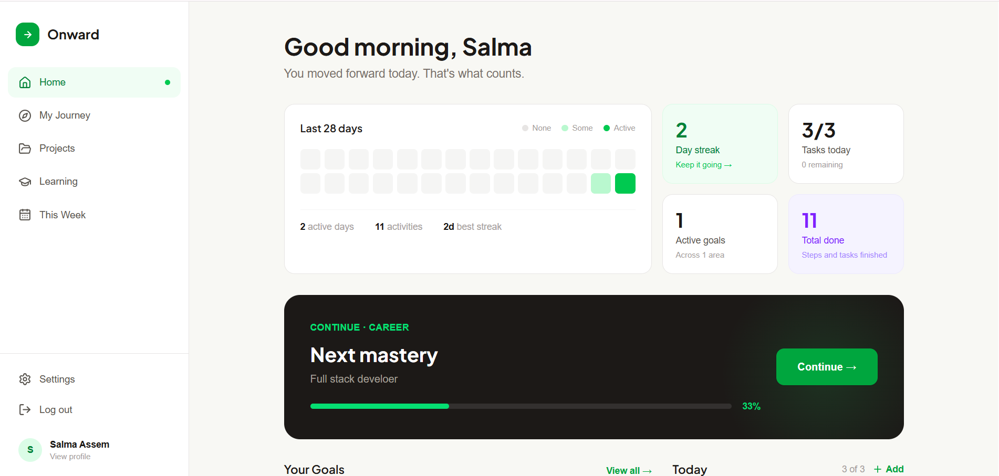
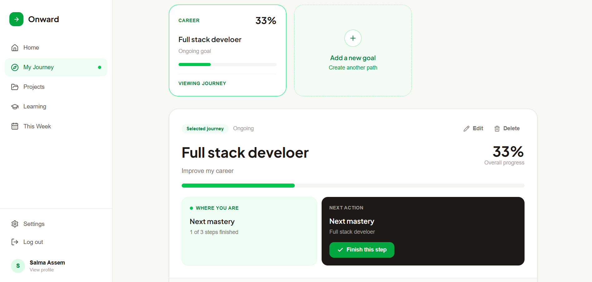
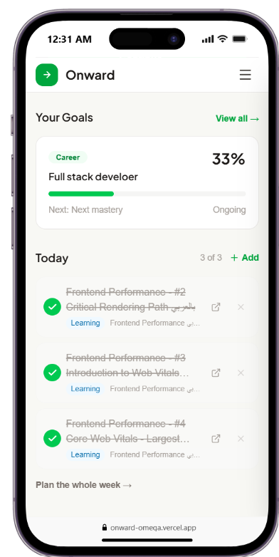

<div align="center">

# Onward

**See where you are. Know what's next.**

A calm, visual progress companion. Onward turns your goals, projects and courses into one journey, so you always know your next step.


</div>

<p align="center">
    
  </p>
  <p align="center">
    
  </p><p align="center">
    
  </p>

---

## Table of contents

- [About](#about)
- [Features](#features)
- [Tech stack](#tech-stack)
- [Getting started](#getting-started)
- [Environment variables](#environment-variables)
- [Scripts](#scripts)
- [Project structure](#project-structure)
- [How it works](#how-it-works)
- [Database](#database)
- [Security](#security)
- [Deployment](#deployment)
- [Troubleshooting](#troubleshooting)
- [Known limitations and roadmap](#known-limitations-and-roadmap)
- [Author](#author)
- [License](#license)

---

## About

Most productivity apps are long to-do lists that make you feel behind. Onward is built around one idea: **keep moving forward, one step at a time.**

You create goals and break them into steps. You build projects with milestones, follow courses lesson by lesson, and plan your week. Onward connects all of it, shows your position on the path, and always surfaces the single next thing to do.

It is a full-stack app: real accounts, a real database, server-side validation, and a design that works from a phone to a wide desktop.

## Features

### Goals and Journey
- Goals with a category, a description, a target date and ordered **steps**, each with optional **sub-steps**.
- A **journey path** that shows what is finished, where you are, and what comes next.
- A "Where you are" and "Next action" panel with a one-click **Finish this step** button.
- Reorder unfinished steps and sub-steps with arrows.
- Optional **target dates** on steps and sub-steps, with overdue highlighting.
- Progress is calculated from finished steps, so it can never get out of sync.

### Projects
- Milestones with optional tasks, and progress calculated from them.
- Connect a project to one of your goals, or keep it as a **freelance** project.
- A GitHub link at any time, and a **live link that unlocks only when the project is finished**.
- Active and Paused statuses. Completed is automatic.

### Learning
- Courses with modules and lessons, and a **Continue** button that opens the exact next lesson.
- **Automatic import from a link:**
  - YouTube playlist: every video becomes a lesson, each with its own link.
  - YouTube video: chapters from the description become lessons.
  - Udemy, Coursera and other sites: title and image when the page shares them.
  - Or paste a list of lessons, or add everything by hand.
- You stay in control: Onward never marks a lesson finished for you.

### This Week
- A weekly planner with past and future weeks.
- Plan real items from your goals, projects and courses, or add your own tasks.
- Ticking a planned item also ticks it in its Journey, Project or Course.
- Move unfinished tasks to today or tomorrow.

### Home
- Day streak, a 28-day activity heatmap and live stats.
- A slider that continues each of your unfinished goals.
- Today's list, with quick add.
- Everything is calculated from the real finish times of your steps, tasks and lessons.

### Account and settings
- **Sign up and sign in with Google**, or with an email and password.
- Editable name, read-only email, and a profile picture.
- **Light, dark and system themes.**
- Change password from a modal.
- Password reset by email.
- Delete your account (asks for your password).

### Experience
- Skeleton loading screens that match the real pages.
- Validation shown both under the field and as a toast, with scroll to the first error.
- Confirmation dialogs before deleting or logging out.
- A slide-in menu on mobile, and bottom-sheet dialogs.
- Custom 404 and error pages.

## Tech stack

| Area | Choice |
|---|---|
| Framework | [Next.js](https://nextjs.org) (App Router, Server Components, Server Actions) |
| Language | TypeScript |
| UI | React, [Tailwind CSS](https://tailwindcss.com) v4, [lucide-react](https://lucide.dev) icons |
| Fonts | Inter and Plus Jakarta Sans through `next/font` |
| Database | [Neon](https://neon.tech) serverless PostgreSQL |
| ORM | [Drizzle ORM](https://orm.drizzle.team) and `drizzle-kit` |
| Auth | Own implementation: bcrypt, database sessions, httpOnly cookies, and Google sign-in (OAuth 2.0 with PKCE) |
| Email | [Resend](https://resend.com) through its REST API (no SDK) |
| Course import | YouTube Data API v3 and page metadata |
| Toasts | react-toastify |

## Getting started

### Prerequisites

- Node.js 20.9 or newer
- A free [Neon](https://neon.tech) account (for the PostgreSQL database)

### Installation

```bash
# 1. Clone the repository
git clone https://github.com/your-username/onward.git
cd onward

# 2. Install dependencies
npm install
```

### Set up the database

1. Create a project on Neon and copy its **connection string**.
2. Create a file named `.env.local` in the project root (see [Environment variables](#environment-variables)).
3. Create the tables:

```bash
npm run db:push
```

### Run it

```bash
npm run dev
```

Open [http://localhost:3000](http://localhost:3000), create an account, and add your first goal.


| Variable | Required | Used for |
|---|---|---|
| `DATABASE_URL` | Yes | Connection to Neon PostgreSQL |
| `YOUTUBE_API_KEY` | No | Playlist and chapter import. Without it, a YouTube link only fills the title and image. |
| `GOOGLE_CLIENT_ID`, `GOOGLE_CLIENT_SECRET` | No | "Continue with Google". Without them, the Google button shows a friendly message. |
| `RESEND_API_KEY` | No | Sending the password reset email |
| `EMAIL_FROM` | No | The sender address. It must belong to a domain verified in Resend. |
| `APP_URL` | No | The address used inside the reset link. Use `https://your-domain` in production, with no trailing slash. |

> **Email testing tip:** before your domain is verified, Resend only lets you send from `onboarding@resend.dev` to your own Resend account email. Verify a domain to email anyone.

**Getting a YouTube API key:** create a project in Google Cloud Console, enable **YouTube Data API v3**, then create an API key and restrict it to that API. Do not restrict it to websites, because Onward calls YouTube from the server.

**Setting up Google sign-in:** in the same Google Cloud project, configure the OAuth consent screen, then create an **OAuth client ID** of type *Web application*. Add `http://localhost:3000/api/auth/google/callback` (and your production address with the same path) as an authorized redirect URI.

## Scripts

| Command | What it does |
|---|---|
| `npm run dev` | Starts the development server |
| `npm run build` | Creates the production build |
| `npm start` | Runs the production build |
| `npm run db:push` | Syncs the database tables with `db/schema.ts` |
| `npm run db:studio` | Opens Drizzle Studio to browse your data |

## Project structure

```
app/
  (marketing)/        Landing page
  (auth)/             Login, signup, forgot and reset password
  (app)/              The signed-in app
    dashboard/          Home
    journey/            Goals and journey
    goals/              New and edit goal forms
    projects/           Projects, new and edit
    learning/           Courses, new and edit
    week/               Weekly planner
    settings/           Profile, appearance, security
  actions/            Server Actions (the app's backend)
  api/avatar/         Cached profile picture route
  api/auth/google/    Google sign-in (start and callback)
  error.tsx, not-found.tsx, global-error.tsx

components/
  app/ journey/ projects/ learning/ plan/ settings/    Feature components
  landing/ skeletons/ ui/                              Shared pieces

db/                   Drizzle schema and connection
lib/                  Domain logic, validation, queries and helpers
```

A few folders are worth a note:

- **`lib/`** holds the rules of the app. Files like `goals.ts`, `projects.ts` and `learning.ts` contain no React, so the same validation runs in the browser and on the server.
- **`app/actions/`** is the backend. Every action checks who you are and filters data by your user id.
- **`app/(app)/*/loading.tsx`** are the skeleton screens.

## How it works

### Server Components and Server Actions as the backend
Pages are Server Components that read from the database directly. Changes go through Server Actions. The browser never talks to the database and never sees its credentials. Only the small interactive parts are Client Components.

### Progress is calculated, not stored
Nothing stores a percentage, so it cannot drift out of sync.

- **A step** is its finished sub-steps divided by its total. With no sub-steps, it is just done or not done.
- **A goal** is the average of its steps. The same rule applies to projects (milestones and tasks) and courses (lessons).
- **The current step** is the first unfinished one. The **next action** is the first unfinished sub-step inside it.

### Activity comes from timestamps
Every step, task and lesson records when it was finished. The streak, the heatmap and the totals are calculated from those times, in your own time zone. Unticking something removes it from your activity.

### Linked planning
A planned item in This Week points to the real step, task or lesson, instead of copying it. That is why ticking it in one place updates everywhere, and why nothing is counted twice.

### Importing a course
The import fetches what a link allows and fills the form for you to review before saving.

| Link | Title and image | Lessons |
|---|---|---|
| YouTube playlist | Yes | Yes, every video (up to 200) |
| YouTube video | Yes | Yes, when the description has chapters |
| Udemy, Coursera | From the page or the link | No. Paste a list instead. |
| Other websites | If the page shares them | No |

Udemy and Coursera do not offer an open way to read their lesson lists, so Onward does not try to scrape them. Every request the server makes for a link first checks that the address is public, to prevent server-side request forgery.

```

A planned item (`plan_items`) is either a custom task, or a link to one step, sub-step, milestone, task or lesson. Deleting a goal keeps its projects and courses, and they become unconnected.

## Security

- **Passwords** are hashed with bcrypt (cost 12). Length is limited to 72 bytes, the limit bcrypt actually uses.
- **Sessions** are random tokens in an `httpOnly`, `SameSite=Lax` cookie (`Secure` in production). Only a SHA-256 hash of the token is stored, so a leaked database cannot be used to sign in.
- **No tokens in the browser's storage.** Nothing sensitive is reachable from JavaScript.
- **Google sign-in** uses the authorization code flow with PKCE and a random `state` check, and only accepts verified Google emails. An existing password account is never linked automatically.
- **Validation runs twice.** The browser validates for convenience, and the server validates again for safety.
- **Ownership checks.** Every query filters by the signed-in user, which prevents opening someone else's data by guessing an id.
- **Rate limiting** on sign-in, signup, password reset and other sensitive actions, stored in PostgreSQL.
- **No account guessing.** Login and password reset give the same answer whether or not an email exists, and the reset email is sent after the response so timing does not leak it.
- **Password reset links** are single-use, expire in 30 minutes, and are stored only as hashes. A new request cancels the old link, and a reset signs out every device.
- **Uploads** are resized in the browser, then checked on the server by their real file signature and size. They are served with `nosniff` and a locked-down content policy.
- **Link safety.** Saved links must be `http` or `https`, and course imports refuse private and internal addresses.
- **Secrets stay on the server.** Server-only modules use the `server-only` package, so importing them into client code fails the build.

> Found a security issue? Please report it privately to the author instead of opening a public issue.

## Deployment

Onward is designed for [Vercel](https://vercel.com) with Neon. SQLite would not work there, because serverless hosts do not keep local files.

## Troubleshooting

| Problem | Fix |
|---|---|
| `db:push` fails with "cannot be cast automatically to type integer" | An older table with the same name has a different shape. Drop the old tables in the Neon SQL Editor, then run `npm run db:push` again. |
| Signup says "Something went wrong" | Check the terminal running `npm run dev`. Usually the tables don't exist yet, or `DATABASE_URL` is missing. Restart the server after editing `.env.local`. |
| YouTube import only gives a title | `YOUTUBE_API_KEY` is missing, YouTube Data API v3 is not enabled for it, the key is restricted to websites, or the playlist is private. The notice on the form shows the reason. |
| Google sign-in shows `redirect_uri_mismatch` | The redirect URI in Google Cloud must exactly match `APP_URL` plus `/api/auth/google/callback`. |
| Google sign-in says access is blocked | The consent screen is in Testing mode. Add your Google account as a test user, or publish the app. |
| Reset email does not arrive | Look for `Password reset email failed:` in the logs. Make sure `EMAIL_FROM` uses your verified domain, and check the spam folder. |
| Reset link opens `localhost` | `APP_URL` is wrong in your hosting settings. |
| Dark mode flashes on reload | Make sure the theme script in `app/layout.tsx` is in the `<head>`. |

## Known limitations and roadmap

**Limitations**

- Neon's HTTP driver does not support multi-step transactions. Updates that touch several tables run as separate queries.
- Profile pictures are stored in the database. That is fine at this size, but object storage (such as Vercel Blob or S3) is the better choice at scale.
- The schema is synced with `db:push`. Once real users exist, switch to `drizzle-kit generate` and `migrate`, which keep a history of every change.
- There are no automated tests yet.
- Dark mode works by remapping the colour palette, and it has not been reviewed on every screen.


## Author

Built by **[Salma Assem](https://github.com/salmaassem-eng)**.

The interface started as a Figma design and was implemented by hand with Next.js.

## License

This is a personal portfolio project. All rights reserved unless a `LICENSE` file in this repository says otherwise.
